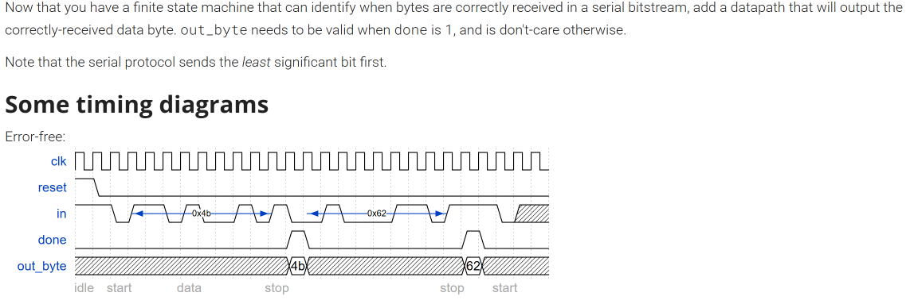
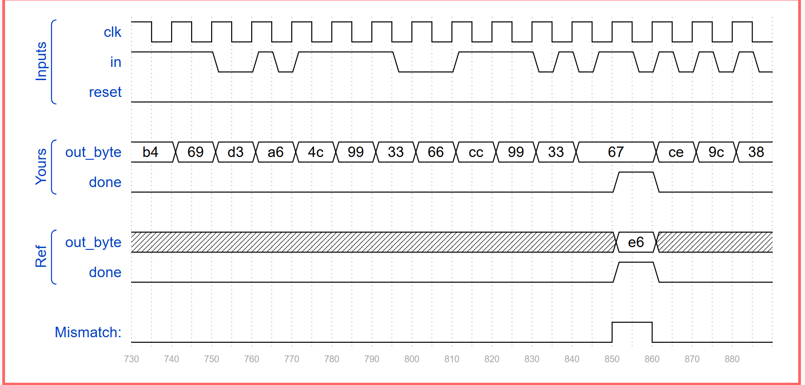

我的代码
```
module top_module(
    input clk,
    input in,
    input reset,    // Synchronous reset
    output [7:0] out_byte,
    output done
); //
    parameter IDLE = 2'b00, DATA = 2'b01, STOP = 2'b10, WAIT = 2'b11;
    reg [1:0] state, next_state;
    reg [3:0] count;
    
    always @(*) begin
        case (state)
            IDLE: next_state = in ? IDLE : DATA;
            DATA: next_state = count == 7 ? STOP : DATA;
            STOP: next_state = in ? IDLE : WAIT;
            WAIT: next_state = in ? IDLE : WAIT;
        endcase
    end
    always @(posedge clk) begin
        if (reset) begin
            state <= IDLE;
            count <= 0;
            done <= 0;
            out_byte <= 0;
        end
        else begin
            if (state == DATA) 
                count <= count + 1'b1;
            else
                count <= 0;
            state <= next_state;
            if (state != STOP)
            	out_byte <= {out_byte[6:0], in};
            
            done <= (state == STOP) & in; //上升沿前状态
        end
    end

    // Use FSM from Fsm_serial

    // New: Datapath to latch input bits.

endmodule
```
报错




- 分析

 0x67 = 0110_0111

 0xe6 = 1110_0110

 没理解题意，in先放到地位，然后依次放到更高位

- 总结{}

 高位在左侧，低位在右侧

 故应该改成

 {in, out_byte[7:1]}

