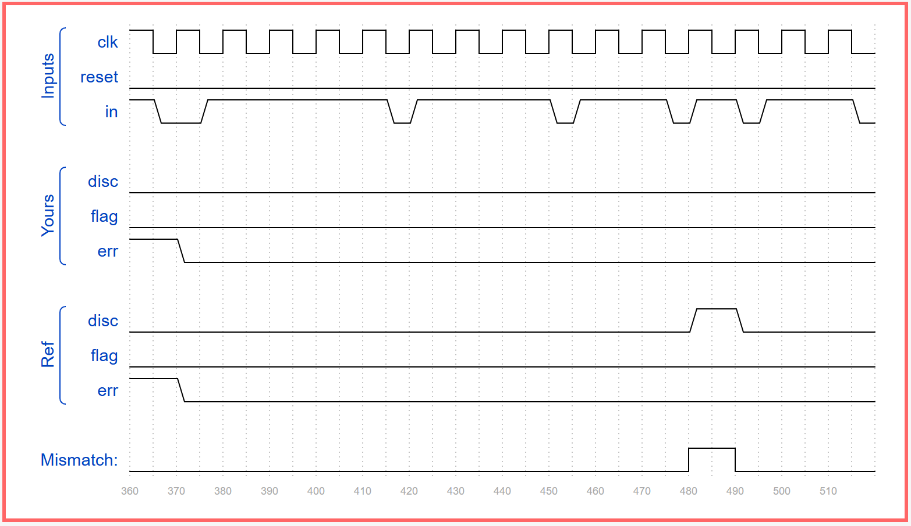
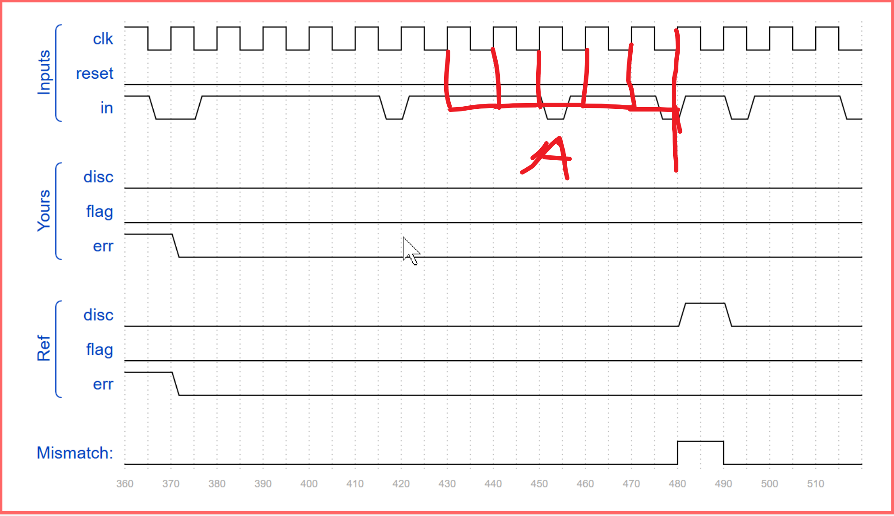
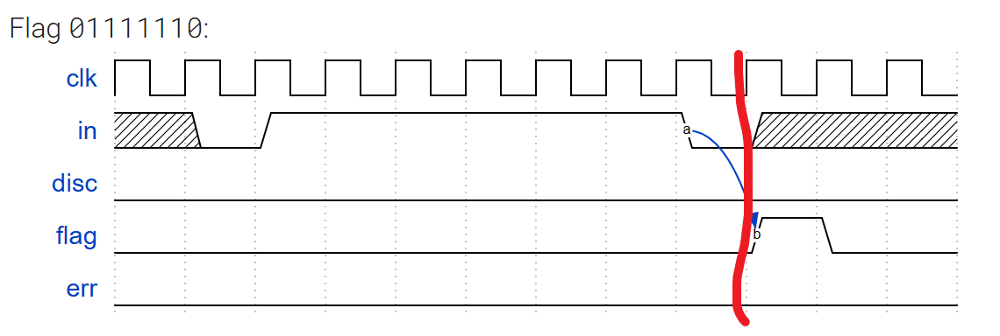
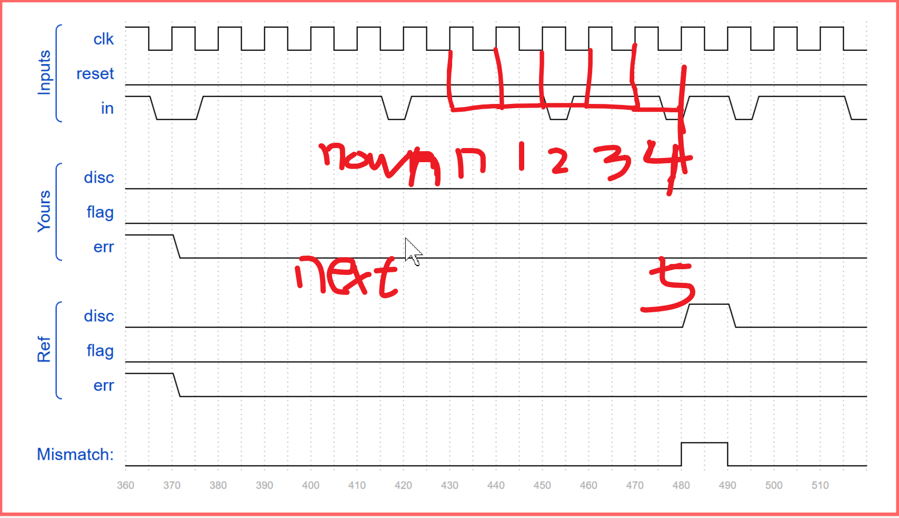

```
module top_module(
    input clk,
    input reset,    // Synchronous reset
    input in,
    output disc,
    output flag,
    output err);
    reg [7:0] temp;
	parameter none = 4'b0000, one = 4'b0001, two = 4'b0010, three = 4'b0011, four = 4'b0100, five = 4'b0101,six = 4'b0110,
    error = 4'b0111, discard= 4'b1000, FLAG = 4'b1001;
    reg [2:0] state, next_state;

    
    always @(*) begin
        case (state)
            none: next_state = in ? one : none;
            one: next_state = in ? two : none;
            two: next_state = in ? three : none;
            three: next_state = in ? four : none;
            four: next_state = in ? five : none;
            five: next_state = in ? six : discard;
            six: next_state = in ? error : FLAG;
            discard: next_state = none;
            error: next_state = in ? error : none;
        endcase
    end
    always @(posedge clk) begin
        if (reset)
            state <= none;
        else 
            state <= next_state;
    end
    assign disc = (state == discard);
    assign flag = (state == FLAG);
    assign err = (state == error);
        
    
    

endmodule
```






## 题意：
题目是上升沿检测5个1然后在检测到0的上升沿更新discard为1；

## 代码存在问题为什么实现不了
位宽不够。。。。。


还有的问题注意，
上升沿要把next_state 赋值给state，next_state 中的in不是看上一时刻的in，而是看上升沿时刻的in，比如上面的红色是错误的，430到440state应该是one，因为430时刻的in就是1；


### ai 总结
FSM 中，next_state 是组合逻辑，由当前 state 和 in 决定，会随着输入和状态变化而重新计算。每当时钟上升沿到来，如果没有复位，寄存器就将上升沿前计算好的 next_state 更新到 state。因此不能直接使用上一个时钟周期开始时的 in 来判断状态转移，而应该看当前上升沿到来之前稳定的 next_state。例如 430 时刻 in=1，上升沿前 state=none、next_state=one，所以 430～440 期间 state=one