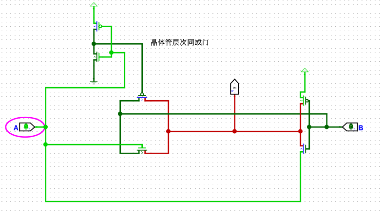

# 一

- 传输门当成自带非门
- 非门的晶体管的方向

### 分析反思
1. *NMOS 的源极通常连接 GND（0V）。*
 *PMOS 的源极通常连接 VDD（例如 3.3V）*
2. **源极栅极由电压决定**

# 二
logisim传输门mos也要注意摆放方向，有时还会没改成nmos
- **pmos 当源极为高栅极为低时，将漏极拉高**
### 反思
传输门导通时，nmos栅极为高，pmos栅极为低，输入为高时，pmos导通
输入为低时nmos导通。

# 三
同或门摆放时遇到这种问题

通过参考提供的异或门把电源与非a相连得以解决

### 分析反思
- 当连接电源时a 为高电平，理想的话就是传输门导通，非门不导通，b经过传输门直接控制Y
- 非门，nmos源极为高电平不导通，pmos源极为高电平，当b为0时pmos的栅极为低电平，所以pmos会导通，变成高电平，此时与b经过传输门为0产生冲突。
- 如果要让a控制b的非门，不光要控制nmos,也要控制pmos。
